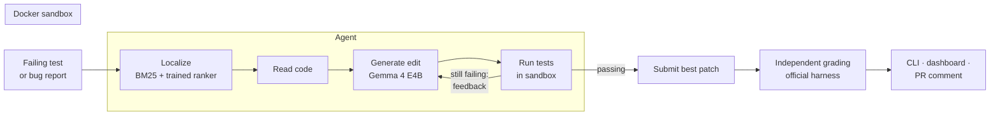

# PatchPilot

[](https://github.com/Tejaswiniprabhakaran/patchpilot/actions/workflows/ci.yml)


**An AI agent that fixes real bugs and proves it.** PatchPilot reads a failing test, locates the
bug with a trained fault-localization model, asks an open LLM (Google's Gemma 4) for a fix, runs the
tests in a network-isolated Docker sandbox, and retries with the test feedback. It ships with a
CLI, a web dashboard, a GitHub bot that comments proposed fixes on failing pull requests, and an
evaluation harness on SWE-bench Lite and QuixBugs.

> **Status (October 2026).** All the software is built and tested (172 unit tests, CI green). The
> experiments are only partly run: the ranker and the fine-tuned model still need their Kaggle
> training runs, and the baseline (B0) has finished 16 of 40 QuixBugs bugs. Every number below
> comes from a file in `results/`; anything not yet run says so.

## How it works



| Software half | AI half |
|---|---|
| **Sandbox**: Docker, network off, CPU/memory/pid limits, no host mounts | **Fault localization**: BM25 baseline and a fine-tuned UniXcoder cross-encoder |
| **Agent**: six sandboxed tools, retry loop, full trajectories | **Patch generator**: QLoRA fine-tuning of Gemma 4 E4B on bug fixes |
| **CLI**: `patchpilot fix / eval / show / dashboard` | **Retrieval**: code embeddings + FAISS |
| **GitHub bot**: comments a verified fix on failing PRs | **Evaluation**: baselines, ablations, exact McNemar tests |
| **Dashboard**: runs, trajectories, diffs, metrics, live "Try it" | **Failure analysis**: rules + LLM judge, checked against manual labels |
| **Quality**: tests, CI, strict typing, linting, docs | **Model and dataset cards**, leakage check |

More: [architecture](docs/architecture.md) · [design decisions](docs/decisions.md) ·
plain-English explainers in [`docs/explained/`](docs/explained/).

## Results so far

**Benchmarks are trustworthy** (`results/sanity_summary.csv`): every instance fails on the buggy
code and passes with the developers' own fix inside the sandbox.

| Benchmark | Instances | Valid |
|---|---|---|
| QuixBugs (Python) | 40 | 40 |
| SWE-bench Lite, seeded 50-instance subset | 50 | 49 (`psf__requests-1963` needs the internet) |

**Fault-localization baseline** on 1,212 instances from 4 repositories never used for training
(`results/localization/heldout_bm25_test.json`; re-ranking each instance's candidates):

| BM25 | Top-1 | Top-3 | Top-5 | MRR |
|---|---|---|---|---|
| Function level (≈112 candidates) | 25.8% | 43.0% | 52.9% | 0.390 |
| File level (≈5 candidates, gold always present) | 52.2% | 89.7% | 98.1% | 0.712 |

**Training data** (leakage check: zero overlap with all 300 SWE-bench Lite test instances on
repository, id, issue text and patch, `results/leakage_check.json`):
6,329 / 1,020 / 1,212 localization instances and 3,063 / 494 / 580 fix-generation chats
(train / validation / test, split by repository), published on the Hugging Face Hub as
[`patchpilot-localization`](https://huggingface.co/datasets/Tejaswiniprabhakaran19/patchpilot-localization)
and [`patchpilot-patchgen`](https://huggingface.co/datasets/Tejaswiniprabhakaran19/patchpilot-patchgen).

**Experiments** (`results/summary/summary.md`, regenerated by `scripts/summarize_results.py`):

| Config | Localization | Patch model | QuixBugs | SWE-bench subset |
|---|---|---|---|---|
| B0 | LLM search | base Gemma 4 E4B | in progress (16/40 run) | TODO: not yet run |
| E1 | trained ranker | base | TODO: not yet run | TODO: not yet run |
| E2 | LLM search | fine-tuned | TODO: not yet run | TODO: not yet run |
| E3 / E4 | trained ranker | fine-tuned, 3 / 1 attempts | TODO: not yet run | TODO: not yet run |

## Quickstart

Requirements: Python 3.11, Docker Desktop, [Ollama](https://ollama.com).

```bash
git clone https://github.com/Tejaswiniprabhakaran/patchpilot.git
cd patchpilot
python -m venv .venv
.venv\Scripts\activate          # Linux/macOS: source .venv/bin/activate
pip install -e ".[dev,bench,dashboard]"
ollama pull gemma4:e4b
```

Fix one bug and look at what the agent did:

```bash
patchpilot fix --benchmark quixbugs --instance gcd
patchpilot show <run_id>
patchpilot dashboard            # http://127.0.0.1:8765
```

## Reproducing the experiments

```bash
python scripts/sanity_gold_patches.py --benchmark quixbugs        # benchmark sanity check
python scripts/sanity_gold_patches.py --benchmark swebench-lite
patchpilot eval --config configs/exp_baseline.yaml                 # B0 (resumable)
python scripts/eval_localization.py --setting heldout --methods bm25 cross_encoder \
    --model Tejaswiniprabhakaran19/patchpilot-fl-cross-encoder
python scripts/summarize_results.py && python scripts/make_figures.py
python scripts/classify_failures.py                                # failure taxonomy
```

Training runs on a free Kaggle T4: `notebooks/01_fault_localization.ipynb` (ranker) and
`notebooks/02_patch_generator_lora.ipynb` (QLoRA, converted to GGUF for Ollama). Long experiments
can run detached at low priority with `scripts/run_detached.ps1`.

## GitHub bot

Copy [`github_action/example-workflow.yml`](github_action/example-workflow.yml) into a repository's
`.github/workflows/`. When the tests of a pull request fail, PatchPilot comments a proposed diff,
verified in the sandbox. It runs Gemma 4 E4B with Ollama on the runner, so no API key is needed,
and it **never pushes commits or merges**.

## Limitations

- **CPU scale.** All experiments use the small Gemma 4 E4B on a laptop CPU (no GPU): minutes per
  model call, so the evaluation set is QuixBugs (40) plus 10 SWE-bench Lite instances
  (decision D12). Results describe a small open model, not the state of the art.
- **Not leaderboard-comparable.** The agent sees the failing test (the CI-bot setting, D8); the
  public SWE-bench leaderboard hides it.
- **Small samples.** With 10 SWE-bench instances, differences between configurations will rarely
  be statistically significant; QuixBugs carries most of the statistical power.
- Python only.

## Repository layout

```
src/patchpilot/   sandbox · tools · agent · llm · localization · patchgen · benchmarks
                  evaluation · analysis · dashboard · bot · cli.py
configs/          experiment YAML and the seeded SWE-bench subsets
notebooks/        Kaggle training notebooks
scripts/          data building, evaluation, figures, failure analysis, launchers
results/          raw results (JSONL, trajectories) and generated summaries
docs/             architecture, decisions, explainers, model and dataset cards
github_action/    the GitHub Action
```
