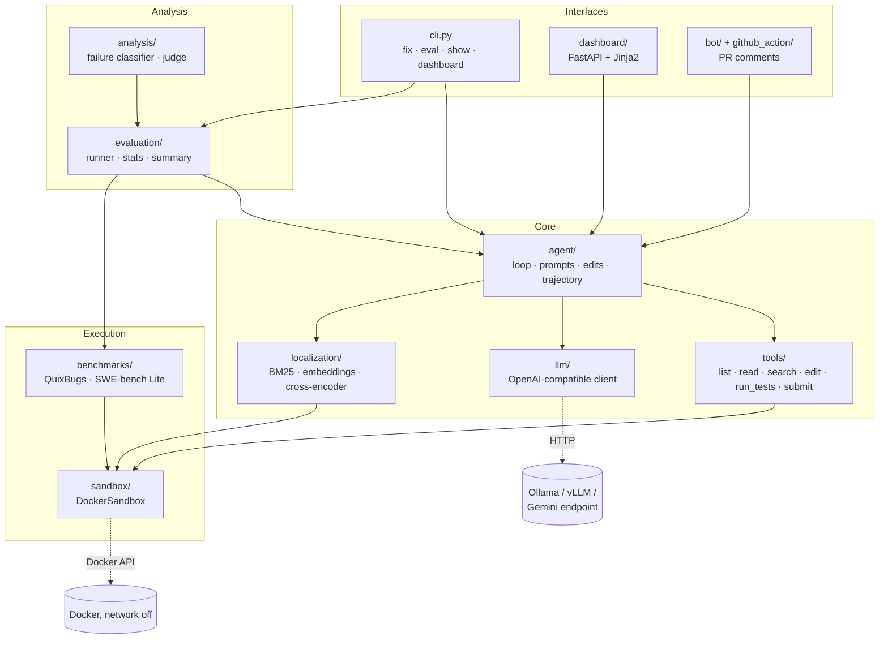
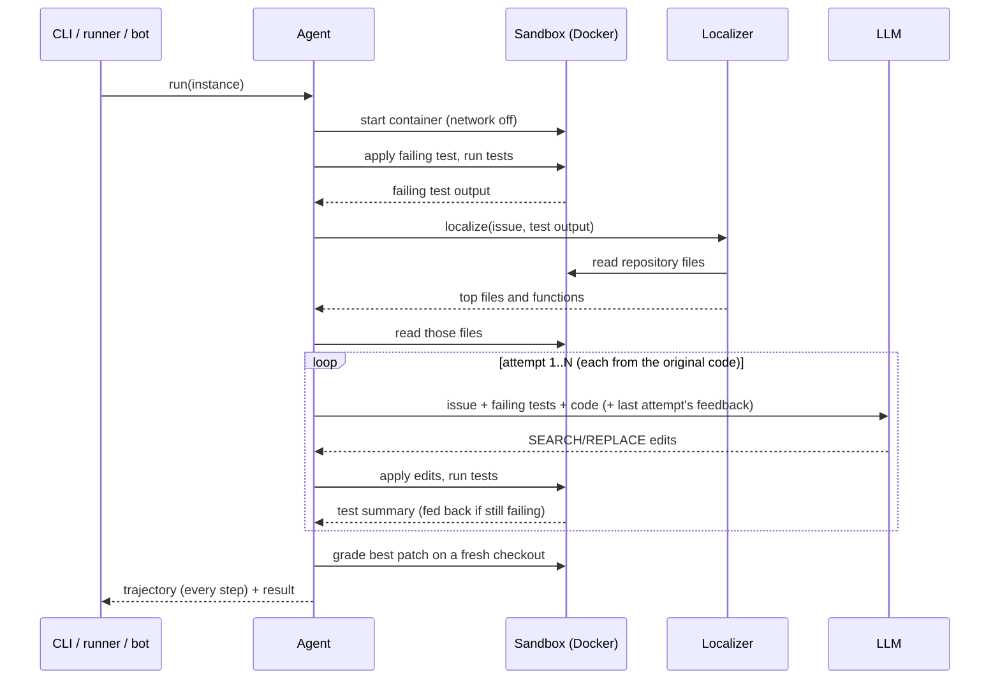
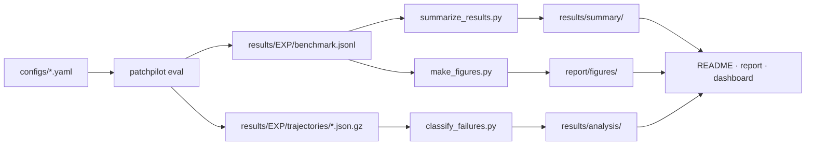

# Architecture

PatchPilot is a Python package (`src/patchpilot`) with one rule at its centre: **code from a
repository under repair only ever runs inside the Docker sandbox.** Everything else (the agent,
the models, the evaluation, the dashboard and the bot) talks to the sandbox through a small API.

## Components

| Package | Responsibility | Explainer |
|---|---|---|
| `sandbox` | Container per instance: no network, resource limits, no host mounts, timeouts, safe patching | [sandbox.md](explained/sandbox.md) |
| `benchmarks` | Instances, the resolution rule, QuixBugs and SWE-bench Lite loaders, sanity check | [benchmarks.md](explained/benchmarks.md) |
| `tools`, `agent`, `llm` | The six tools, the retry loop, prompts, SEARCH/REPLACE parsing, trajectories, model client | [agent.md](explained/agent.md) |
| `localization` | Labels from patches, BM25, embedding retrieval, cross-encoder, `RankerLocalizer` | [localization.md](explained/localization.md) |
| `patchgen` | Fine-tuning data in the agent's own prompt format | [patch_generator.md](explained/patch_generator.md) |
| `evaluation` | Experiment runner, scoring rules, statistics, results tables | (this page) |
| `analysis` | Failure classifier, LLM judge, manual-label agreement | [failure_analysis.md](explained/failure_analysis.md) |
| `dashboard` | Web UI over `results/` and `runs/`, live Try-it runs | (this page) |
| `bot` | Pull-request bot and GitHub Action | [github_bot.md](explained/github_bot.md) |

## One agent run

## Data flow of an experiment

Every number shown anywhere is computed from the files on the left, and every table names its
source file.

## Machine and resource rules

The development laptop has no NVIDIA GPU and hosts other projects, so: experiments run Gemma 4 E4B
on the CPU (D12), training runs on Kaggle, at most one SWE-bench image exists at a time, long jobs
run detached at Below Normal priority with a duplicate guard, and PatchPilot stays under 10 GB of
disk (D14).
